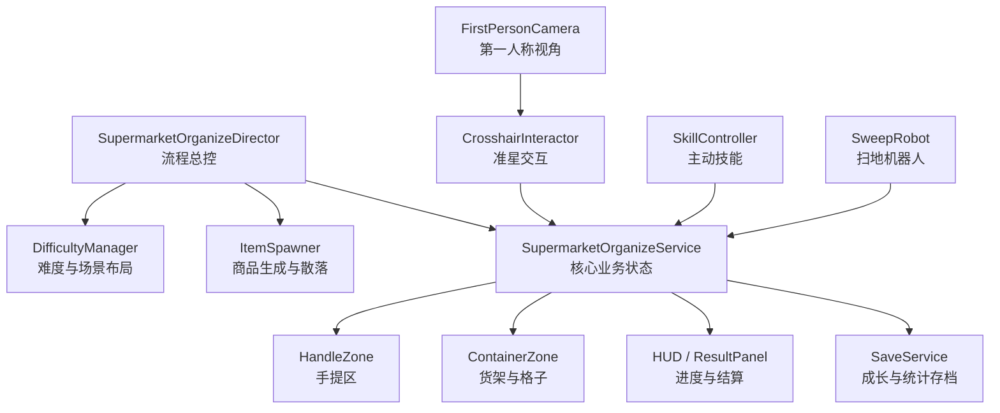

# 超市收纳（Supermarket Organize）项目说明

> 本文只描述“超市收纳”游戏。内容依据当前仓库中的 Unity 场景、C# 源码和 ScriptableObject 配置整理，适合开发接手、功能修改和问题排查。

## 1. 游戏概览

“超市收纳”是一款第一人称休闲整理游戏。玩家需要把散落在地面的商品捡入手提区，再根据商品类型放入对应货架。所有商品正确归位、所有货架填满后完成挑战。

核心体验可以概括为：

```text
选择难度 → 商品散落 → 瞄准拾取 → 手提区暂存
         → 寻找对应货架 → 正确上架 → 获得金币
         → 全部归位 → 结算 → 升级属性和技能
```

主场景：[`SupermarketOrganizeScene.unity`](../Assets/Game/Modes/SupermarketOrganize/Scenes/SupermarketOrganizeScene.unity)

运行时代码：[`Assets/Game/Scripts/SupermarketOrganize`](../Assets/Game/Scripts/SupermarketOrganize)

内容配置：[`Assets/Game/Modes/SupermarketOrganize/Content`](../Assets/Game/Modes/SupermarketOrganize/Content)

## 2. 玩家流程

### 2.1 进入游戏

场景启动后由 `SupermarketOrganizeDirector` 决定是否先显示模式内主页：

1. 如果需要显示主页，玩家先选择“杂货店”或“超级市场”。
2. 如果从外部主页直接启动，使用默认难度并跳过模式内主页。
3. 应用所选难度，启用对应货架和商品布局。
4. 创建运行时对象关系，清理上一次挑战残留。
5. 生成并散落商品。
6. 播放入场流程，随后允许玩家操作。

入口代码：[`SupermarketOrganizeDirector.cs`](../Assets/Game/Scripts/SupermarketOrganize/SupermarketOrganizeDirector.cs)

### 2.2 拾取商品

玩家通过屏幕中心准星进行射线检测：

- 默认最大交互距离为 8 米。
- 准星指向地面商品时，显示可拾取反馈和商品高亮。
- 拾取成功后，商品以弧线动画移动到手提区。
- 手提区已满时不能继续拾取。
- 玩家可以切换当前准备放置的手持商品。

主要代码：

- [`SupermarketCrosshairInteractor.cs`](../Assets/Game/Scripts/SupermarketOrganize/SupermarketCrosshairInteractor.cs)
- [`SupermarketHandleZone.cs`](../Assets/Game/Scripts/SupermarketOrganize/SupermarketHandleZone.cs)
- [`SupermarketItemHighlightController.cs`](../Assets/Game/Scripts/SupermarketOrganize/SupermarketItemHighlightController.cs)

### 2.3 放置商品

货架由 `SupermarketContainerZone` 表示。每个货架具有目标商品 ID 和若干摆放格：

- 当前商品与货架商品 ID 相同时可以放置。
- 匹配时显示“正确的货架”和绿色预览反馈。
- 不匹配时显示“错误的货架”。
- 商品放置完成后占用一个货架格子。
- 货架第一次被填满时触发货架完成奖励和表现效果。

主要代码：

- [`SupermarketContainerZone.cs`](../Assets/Game/Scripts/SupermarketOrganize/SupermarketContainerZone.cs)
- [`SupermarketShelfFeedbackUi.cs`](../Assets/Game/Scripts/SupermarketOrganize/SupermarketShelfFeedbackUi.cs)
- [`SupermarketOrganizeService.cs`](../Assets/Game/Scripts/SupermarketOrganize/SupermarketOrganizeService.cs)

### 2.4 胜利条件

`SupermarketOrganizeService.CheckVictory` 同时检查以下条件：

1. 地面剩余商品数量为 0。
2. 手提区没有剩余商品。
3. 已完成货架数等于货架总数。
4. 已放置商品数等于货架格子总数。

满足条件后会停止当前挑战、记录胜利、播放完成表现并打开结算面板。

这组条件是排查“明明摆完却不结算”问题的首要位置。

## 3. 模块架构



### 3.1 流程总控

[`SupermarketOrganizeDirector.cs`](../Assets/Game/Scripts/SupermarketOrganize/SupermarketOrganizeDirector.cs)

负责：

- 模式内主页与直接开局的分流；
- 应用难度；
- 建立运行时对象关系；
- 生成商品；
- 控制入场和 HUD 显隐；
- 监听胜利事件并组织结算数据。

### 3.2 核心业务服务

[`SupermarketOrganizeService.cs`](../Assets/Game/Scripts/SupermarketOrganize/SupermarketOrganizeService.cs)

这是玩法的核心业务类，当前约 833 行。它维护：

- 已注册货架和地面商品；
- 地面、手提区和货架中的商品数量；
- 当前手持商品；
- 拾取、放置、磁铁、自动上架和机器人操作；
- 商品与货架匹配；
- 单件商品和货架完成奖励；
- 胜利条件和挑战统计。

重要事件：

| 事件 | 用途 |
| --- | --- |
| `GameStarted` | 挑战正式开始 |
| `GameWon` | 达成胜利条件 |
| `CurrentItemChanged` | 当前手持商品变化 |
| `HandleCountChanged` | 手提区数量变化 |
| `ProgressChanged` | 货架或商品进度变化 |

### 3.3 第一人称控制与交互

| 文件 | 职责 |
| --- | --- |
| [`PlayerSupermarketOrganizeController.cs`](../Assets/Game/Scripts/SupermarketOrganize/PlayerSupermarketOrganizeController.cs) | 玩家玩法控制入口 |
| [`SupermarketFirstPersonCamera.cs`](../Assets/Game/Scripts/SupermarketOrganize/SupermarketFirstPersonCamera.cs) | 第一人称旋转、俯仰角和角色模型隐藏 |
| [`SupermarketCrosshairInteractor.cs`](../Assets/Game/Scripts/SupermarketOrganize/SupermarketCrosshairInteractor.cs) | 中心射线、目标判断、拾取和放置输入 |
| [`SupermarketCrosshairUi.cs`](../Assets/Game/Scripts/SupermarketOrganize/SupermarketCrosshairUi.cs) | 准星视觉状态 |
| [`SupermarketAimHintUi.cs`](../Assets/Game/Scripts/SupermarketOrganize/SupermarketAimHintUi.cs) | 当前目标提示 |

### 3.4 商品系统

商品由“配置资产”和“场景实例”两部分组成：

- `SupermarketItemDef`：商品 ID、显示名称、世界预制体、生成数量范围。
- `SupermarketItem`：运行时商品实例、当前状态、所属货架和格子。
- `SupermarketItemDatabase`：全部商品定义的索引。
- `SupermarketItemSpawner`：根据货架需求生成并散落商品。

商品状态定义在 [`SupermarketItemState.cs`](../Assets/Game/Scripts/SupermarketOrganize/SupermarketItemState.cs)：

| 状态 | 含义 |
| --- | --- |
| `OnGround` | 位于地面，可拾取 |
| `Moving` | 正在执行拾取或放置动画 |
| `InHandle` | 位于玩家手提区 |
| `OnShelf` | 已放入货架 |
| `InRobotHandle` | 被扫地机器人携带 |

当前商品数据库登记了 **215 项**，商品配置目录中有 **216 个 `.asset` 文件**。这意味着至少有一个商品资产没有进入数据库，维护商品时应检查数据库引用是否完整。

### 3.5 难度与场景布局

当前配置提供两种难度：

| 难度 | 说明 |
| --- | --- |
| 杂货店 | 较小的货架和商品布局 |
| 超级市场 | 更大的货架和商品布局 |

`SupermarketOrganizeDifficultySetup` 保存一个难度对应的货架、商品生成区和场景对象集合；`SupermarketOrganizeDifficultyManager` 负责切换这些集合。

相关文件：

- [`SupermarketOrganizeDifficultySetup.cs`](../Assets/Game/Scripts/SupermarketOrganize/SupermarketOrganizeDifficultySetup.cs)
- [`SupermarketOrganizeDifficultyManager.cs`](../Assets/Game/Scripts/SupermarketOrganize/SupermarketOrganizeDifficultyManager.cs)
- [`SupermarketOrganizeHomeConfig.asset`](../Assets/Game/Modes/SupermarketOrganize/Content/Configs/SupermarketOrganize/SupermarketOrganizeHomeConfig.asset)

体力相关字段仍然存在，两种难度也都配置了 1 点体力消耗，但当前 `staminaEnabled` 为关闭状态，因此正常开局不消耗体力。

## 4. 经济、属性与技能

### 4.1 基础奖励

| 行为 | 当前奖励 |
| --- | ---: |
| 正确放置一件商品 | 3 金币 |
| 首次填满一个货架 | 30 金币 |

奖励配置：[`SupermarketOrganizeConfig.asset`](../Assets/Game/Modes/SupermarketOrganize/Content/Configs/SupermarketOrganize/SupermarketOrganizeConfig.asset)

### 4.2 可升级属性

| 属性 | 作用 | 当前等级趋势 |
| --- | --- | --- |
| `HandleCapacity` | 手提区容量 | 4 → 16 |
| `MoveSpeed` | 玩家移动速度加成 | 0% → 50% |
| `PickupRange` | 有效拾取范围 | 12 → 24 |

注意：基础配置仍包含 `defaultHandleCapacity=16` 和 `maxHandleCapacity=32`，成长配置则定义 4～16 的等级曲线。运行时以成长服务解析出的属性等级为主要来源；修改容量时需要同时核对两套配置，避免出现 UI 与实际容量不一致。

### 4.3 主动技能

| 技能 | 作用 |
| --- | --- |
| `Scanner` 价格扫描器 | 一段时间高亮相同商品，默认持续 8 秒 |
| `Magnet` 磁铁 | 吸取一定半径内商品，默认半径 10 米 |
| `XRay` X 射线 | 显示正确货架提示，默认持续 6 秒 |
| `AutoStocker` 自动存货员 | 自动把手提区商品放到匹配货架 |

技能控制：[`SupermarketOrganizeSkillController.cs`](../Assets/Game/Scripts/SupermarketOrganize/SupermarketOrganizeSkillController.cs)

成长配置：[`SupermarketOrganizeProgressionConfig.cs`](../Assets/Game/Scripts/SupermarketOrganize/Config/SupermarketOrganizeProgressionConfig.cs)

### 4.4 扫地机器人

扫地机器人使用 NavMesh 自动寻找地面商品，再前往匹配货架完成放置：

- 免费激活持续时间：300 秒；
- 自动处理间隔：15 秒；
- 机器人持有商品时使用独立的 `InRobotHandle` 状态。

相关文件：

- [`SupermarketSweepRobotController.cs`](../Assets/Game/Scripts/SupermarketOrganize/SupermarketSweepRobotController.cs)
- [`SupermarketSweepRobotAgent.cs`](../Assets/Game/Scripts/SupermarketOrganize/SupermarketSweepRobotAgent.cs)
- [`SupermarketSweepRobotPanel.cs`](../Assets/Game/Scripts/SupermarketOrganize/SupermarketSweepRobotPanel.cs)

## 5. 配置体系

| 配置 | 主要内容 |
| --- | --- |
| `SupermarketOrganizeConfig` | 交互距离、奖励、动画、第一人称视角、散落和性能参数 |
| `SupermarketItemDatabase` | 商品定义索引 |
| `SupermarketMapDatabase` | 地图与场景名 |
| `SupermarketOrganizeHomeConfig` | 难度入口、体力开关、主页展示 |
| `SupermarketOrganizeProgressionConfig` | 属性和技能等级、价格、冷却时间 |
| `SupermarketOrganizeUpgradeUiConfig` | 升级列表文案、图标和排序 |

关键默认值：

| 参数 | 当前值 |
| --- | ---: |
| 准星最大交互距离 | 8 米 |
| 商品散落随机种子 | 20260707 |
| 单件放置奖励 | 3 金币 |
| 货架完成奖励 | 30 金币 |
| 第一人称视角高度 | 1.55 米 |
| 商品物理落定最长时间 | 8 秒 |
| 地面商品遮挡检测距离 | 14 米 |

## 6. 存档结构

模式存档定义在 [`SupermarketOrganizeModeSaveData.cs`](../Assets/Game/Scripts/Save/SupermarketOrganizeModeSaveData.cs)，包含：

- 当前地图 ID；
- 总挑战次数、总胜利次数；
- 最快通关时间；
- 三项属性等级；
- 四项技能等级；
- 扫地机器人有效期；
- 体力和上次恢复时间；
- 模式独立经济档案；
- 折扣礼包里程碑状态。

商品在一局中的具体位置和货架摆放状态不会被持久化。重新进入场景后会按当前难度重新生成一局。

## 7. UI 组成

| UI | 作用 |
| --- | --- |
| `SupermarketOrganizeHomePanel` | 难度选择和开局 |
| `SupermarketOrganizeHudSection` | 局内总 HUD |
| `SupermarketOrganizeInteractionHud` | 拾取、放置和交互提示 |
| `SupermarketOrganizeSkillHud` | 技能按钮和冷却 |
| `SupermarketShelfFeedbackUi` | 正确/错误货架反馈 |
| `SupermarketOrganizeUpgradePanel` | 属性与技能升级 |
| `SupermarketSweepRobotPanel` | 扫地机器人入口 |
| `SupermarketOrganizeResultPanel` | 通关结算 |

## 8. 性能设计

该模式会同时生成大量带网格、碰撞体和 Rigidbody 的商品，因此专门实现了以下优化：

- 商品落地后检测稳定状态，结束持续物理模拟；
- 可关闭商品阴影；
- 地面商品按距离和遮挡结果隐藏 Renderer；
- 遮挡检测分批执行，而不是每帧检查全部商品；
- 商品拾取和放置通过移动动画完成，避免继续参与自由物理；
- 商品高亮缓存原始材质和 Renderer 状态。

相关代码：

- [`SupermarketItemPhysicsSettle.cs`](../Assets/Game/Scripts/SupermarketOrganize/SupermarketItemPhysicsSettle.cs)
- [`SupermarketGroundItemOcclusionCuller.cs`](../Assets/Game/Scripts/SupermarketOrganize/SupermarketGroundItemOcclusionCuller.cs)
- [`SupermarketItemMotion.cs`](../Assets/Game/Scripts/SupermarketOrganize/SupermarketItemMotion.cs)

在 WebGL 或小游戏平台测试时，重点观察首帧商品生成、商品落地阶段、快速转动视角和磁铁一次吸取多个商品时的帧率。

## 9. 常见修改方式

### 9.1 新增商品

1. 准备商品预制体、Collider 和必要材质。
2. 创建 `SupermarketItemDef`，设置唯一 `itemId`、名称、预制体和生成数量。
3. 将定义加入 `SupermarketItemDatabase`。
4. 在对应难度中配置能容纳该商品的货架。
5. 确保货架目标 `itemId` 与商品完全一致。
6. 验证生成总数与货架格子总数一致。
7. 完整游玩一局，确认胜利条件能够触发。

编辑器已提供商品表格导入、批量设置和货架分配工具，位于 `Assets/Game/Editor` 下的 `Supermarket*` 文件。

### 9.2 新增难度

1. 在场景中建立独立的难度布局根节点。
2. 添加并配置 `SupermarketOrganizeDifficultySetup`。
3. 配置该难度的货架和商品生成区域。
4. 在 `SupermarketOrganizeHomeConfig` 中添加难度入口。
5. 检查显示顺序、预览图和体力消耗。
6. 验证切换难度时其他布局已被关闭。

### 9.3 修改奖励或技能

- 单件和货架奖励：修改 `SupermarketOrganizeConfig.asset`。
- 属性等级、升级价格：修改 `SupermarketOrganizeProgressionConfig.asset`。
- 技能冷却和持续时间：同样修改成长配置。
- 升级面板图标、文案和顺序：修改 `SupermarketOrganizeUpgradeUiConfig.asset`。

## 10. 调试与排障

### 商品无法拾取

检查：

- 商品状态是否为 `OnGround`；
- 商品是否注册到 `SupermarketOrganizeService`；
- 是否存在 Collider；
- 是否在射线检测层；
- 是否超过拾取距离；
- 手提区是否已满。

### 商品无法放到货架

检查：

- 商品 `itemId` 与货架目标 ID 是否完全一致；
- 货架是否还有空格；
- 商品是否为当前手持商品；
- 货架是否属于当前难度并已经注册。

### 全部摆完但不结算

依次检查：

- `RemainingGroundCount` 是否为 0；
- 手提区数量是否为 0；
- `CompletedShelfCount` 是否等于 `TotalShelfCount`；
- `PlacedItemCount` 是否等于 `TotalItemSlotCount`；
- 是否存在没有匹配货架的商品；
- 商品生成数量是否超过或少于货架格子总数。

`SupermarketOrganizeService` 内提供调试填充方法，可用于快速验证货架映射和胜利条件。

### 扫地机器人不工作

检查：

- 激活时间是否仍有效；
- 场景是否已烘焙 NavMesh；
- 商品和货架是否能被服务找到；
- 机器人是否有可达路径；
- 当前商品是否存在匹配货架和空格。

## 11. 已知风险与改进建议

1. **核心服务过大**：`SupermarketOrganizeService` 同时承担库存、货架、技能、机器人、奖励和胜利判定，后续可拆分为库存服务、货架服务和结算服务。
2. **商品资产与数据库数量不一致**：当前目录 216 个商品资产，数据库登记 215 项，建议增加编辑器审计。
3. **容量配置有两套来源**：基础配置和成长配置都定义容量相关数值，建议明确唯一来源。
4. **胜利条件对内容配置敏感**：生成数量、商品 ID 和货架格子只要有一处不匹配，就可能无法正常结算。
5. **物理生成峰值明显**：大量商品同时落地可能造成小游戏平台卡顿，建议保留分批生成或对象池优化空间。
6. **自动化测试缺失**：至少应覆盖商品—货架匹配、奖励、升级消费、存档迁移和胜利条件。
7. **固定随机种子降低重复可玩性**：当前默认布局可复现，方便调试，但正式玩法可考虑按局生成种子并记录在调试日志中。

## 12. 推荐阅读顺序

1. [`SupermarketOrganizeDirector.cs`](../Assets/Game/Scripts/SupermarketOrganize/SupermarketOrganizeDirector.cs)：理解一局如何开始和结束。
2. [`SupermarketOrganizeService.cs`](../Assets/Game/Scripts/SupermarketOrganize/SupermarketOrganizeService.cs)：理解核心规则。
3. [`SupermarketCrosshairInteractor.cs`](../Assets/Game/Scripts/SupermarketOrganize/SupermarketCrosshairInteractor.cs)：理解玩家操作。
4. [`SupermarketItem.cs`](../Assets/Game/Scripts/SupermarketOrganize/SupermarketItem.cs) 与 [`SupermarketContainerZone.cs`](../Assets/Game/Scripts/SupermarketOrganize/SupermarketContainerZone.cs)：理解商品和货架模型。
5. [`SupermarketItemSpawner.cs`](../Assets/Game/Scripts/SupermarketOrganize/SupermarketItemSpawner.cs)：理解内容生成。
6. [`SupermarketOrganizeProgressionService.cs`](../Assets/Game/Scripts/SupermarketOrganize/SupermarketOrganizeProgressionService.cs)：理解养成。
7. [`SupermarketOrganizeModeSaveData.cs`](../Assets/Game/Scripts/Save/SupermarketOrganizeModeSaveData.cs)：理解持久化数据。
8. `Assets/Game/Editor/Supermarket*`：理解商品导入、场景装配和批量维护工具。

---

文档基于当前仓库状态整理。修改商品数据库、难度布局、成长配置或胜利条件后，应同步更新本文。
